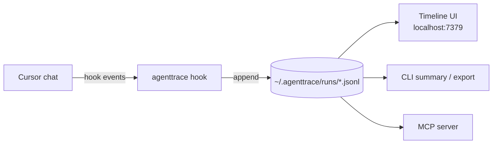

<div align="center">

# agenttrace

**See exactly what your AI coding agent did: every step, every file, and where the effort went.**

A live, local timeline of your Cursor chats. No cloud, no account, no setup beyond one command.


</div>

---

You send one message. The agent reads 14 files, runs 6 commands, takes 3 screenshots, edits 4 files, and replies. In the chat you see only the reply.

**agenttrace shows you everything in between**, live, as it happens:

- 🧭 **Every step, in order.** Prompts, thinking, tool calls, shell commands, file reads and edits, MCP calls, replies.
- 🔥 **Where the effort went.** The heaviest steps of each message, ranked, so you can see what bloated the context.
- 🔁 **When it got stuck.** Repeated identical tool calls, the same file rewritten again and again, failed commands, context compaction.
- 🗂️ **Organized your way.** Chats grouped by project, one timeline per chat, one collapsible section per message.
- 🧑 **Two ways to read it.** *Technical* mode shows raw tool names, arguments and outputs. *Muggle* mode explains the same steps in plain language ("Took a screenshot", "Edited `cart.ts`").

Everything stays on your machine as plain JSONL files.

## Quick start

You need [Node.js](https://nodejs.org) 18 or newer and [Cursor](https://cursor.com).

**1. Get it**

```bash
git clone https://github.com/SArshiaK/agenttrace.git
cd agenttrace
npm install
```

**2. Connect it to Cursor** (once)

```bash
npm run at -- setup-cursor --global
```

This builds agenttrace and adds hooks to `~/.cursor/hooks.json`, so **every chat in every project** is traced. The first run takes a few seconds to build.

**3. Open the timeline**

```bash
npm start
```

Your browser opens [http://127.0.0.1:7379](http://127.0.0.1:7379). Now send a message in Cursor and watch it appear.

That's it. Keep `npm start` running while you want to watch. Recording happens even when it's closed, so you can open the UI later and everything is there.

> [!IMPORTANT]
> The hooks point to this folder (`agenttrace/dist/hook/index.js`). If you move or delete the folder, run `setup-cursor` again from the new location.

<details>
<summary>Trace only one project instead of all of them</summary>

Run this from inside agenttrace, pointing at your project:

```bash
npm run at -- setup-cursor --dir /path/to/your/project
```

This writes `<project>/.cursor/hooks.json` instead. Pick either global or per-project; installing both records every event twice.

</details>

## How it works



Cursor runs [hooks](https://cursor.com/docs/agent/hooks) at each point of a chat: when you submit a prompt, after every tool call, after file edits, after thinking, after replies, before context compaction, and when a turn ends. agenttrace receives each one, redacts anything that looks like a secret, and appends one line to a file for that chat.

- **One chat = one run**, stored as `~/.agenttrace/runs/cursor_<conversation-id>.jsonl`.
- **The project** is the workspace folder Cursor reports, so chats from different projects never mix.
- **The UI only reads those files.** It polls every 2 seconds and never writes, so stopping and restarting it loses nothing.
- **A hook can never break Cursor.** It always answers immediately, and errors go to `~/.agenttrace/hook-errors.log`.

## What's exact and what's estimated

agenttrace never shows a guess as if it were a measurement. Every number in the UI is tagged <kbd>exact</kbd> or <kbd>est.</kbd>, and hovering over a tag explains how the number was produced.

| Exact (reported by Cursor) | Estimated by agenttrace |
|---|---|
| Which tools ran, with their input and output | Tokens per step: text length ÷ 4 |
| How long each step took | Screenshots and images: about 1k tokens each |
| Files edited, errors, prompts, replies, thinking | "≈ N pages" in Muggle mode (about 650 tokens per page) |
| Context size when Cursor compacts (`context_tokens`) | |

> [!NOTE]
> **The token numbers are not your bill.** They measure how much text entered the agent's context. That's good for spotting the heavy steps, but billed usage is usually several times higher, because the model re-reads its whole context on every step. Cursor's hooks don't expose per-step tokens or cost. Exact per-request numbers live in your [Cursor dashboard](https://cursor.com/dashboard) (Usage → Export CSV).

## The timeline

| | |
|---|---|
| **Newest first** | The latest message sits at the top and stays open while the agent works. Earlier messages collapse to a one-line summary. |
| **Insights per message** | Heaviest steps, token breakdown, per-tool totals and a health check, for the selected message or the whole chat. |
| **Filters and search** | Heavy steps, tools, files, thinking and replies, or errors only. Search commands, paths and outputs. |
| **Step inspector** | Click any step to see its full input, output, duration and how its number was estimated. |
| **Pause** | Freeze live updates while you read. |

## Command line

All commands run from the agenttrace folder as `npm run at -- <command>`.

```bash
npm run at -- ls                         # list recorded chats and their run ids
npm run at -- summary <runId>            # health summary of one chat, in the terminal
npm run at -- export <runId> -f md       # shareable Markdown report (also: json, events)
npm run at -- open --port 7400           # the UI on another port
```

| Command | What it does |
|---|---|
| `setup-cursor [--global \| --dir <path>]` | Install the Cursor hooks |
| `open [runId] [--port] [--noOpen]` | Start the timeline UI (`npm start` is a shortcut) |
| `ls` | List runs with their id, status, event count and title |
| `summary [runId]` | Duration, tools, errors, token breakdown, heaviest steps, findings |
| `export [runId] -f md\|json\|events` | Print a report or the raw events to stdout |
| `status` | Store location and current run |
| `start`, `event`, `end` | Record a run by hand (see below) |
| `mcp` | Start the MCP server over stdio |
| `init` | Create the store folder (done automatically) |

Without a `runId`, `summary` and `export` use the run last started with `start`, or else the most recent one. Every command accepts `--home <dir>` to use a different store. You can also set `AGENTTRACE_HOME`.

<details>
<summary>Record events manually (any agent, any script)</summary>

agenttrace isn't tied to Cursor. Anything that can run a command can write to a trace:

```bash
npm run at -- start --title "nightly refactor"
npm run at -- event tool.ended --name Shell --text "npm test"
npm run at -- event file.write --title auth.ts --path src/auth.ts
npm run at -- event error --title "tests failed" --error "3 failing"
npm run at -- end
```

Event types include `tool.started`, `tool.ended`, `file.read`, `file.write`, `file.delete`, `model.request`, `model.response`, `model.thought`, `context.compact`, `error` and `note`. Use `--data '{"key":"value"}'` for arbitrary JSON; on PowerShell, `--text`, `--path` and `--name` save you from quoting.

Each line in the run file is one event:

```ts
type AgentTraceEvent = {
  id: string
  runId: string
  ts: string            // ISO timestamp
  type: string          // e.g. "tool.ended"
  source?: string       // cursor | cli | mcp | ...
  title?: string
  data?: Record<string, unknown>
  durationMs?: number
  error?: { message: string; stack?: string }
}
```

</details>

<details>
<summary>Let an agent write its own trace (MCP)</summary>

Add this to your MCP config (`~/.cursor/mcp.json`), with the path to your clone:

```json
{
  "mcpServers": {
    "agenttrace": {
      "command": "node",
      "args": ["/path/to/agenttrace/dist/mcp/index.js"]
    }
  }
}
```

The agent gets four tools: `start_run`, `log_event`, `end_run` and `get_run_summary`. You don't need this for Cursor tracing; the hooks already record everything.

</details>

## Privacy

- **Your data never leaves your computer.** No telemetry, no account, no uploads. The only outside request is the UI loading its fonts from Google Fonts.
- **The UI listens on `127.0.0.1` only**, so it isn't reachable from your network.
- **Secrets are redacted before they're written.** That covers API keys (`sk-…`, `ghp_…`, `xox…`, `AKIA…`), bearer tokens and `password=` style values.
- **Your prompts and the agent's replies are stored as plain text** in `~/.agenttrace`. Treat that folder like your chat history.

## Troubleshooting

**Nothing shows up after sending a message.** Open *Cursor Settings → Hooks* and check that the agenttrace hooks are listed. If they aren't, restart Cursor. Then check `~/.agenttrace/hook-errors.log`, and make sure `node` works in a terminal, since Cursor runs the hook with it.

**Port 7379 is already in use.** Either agenttrace is already running (just open the URL), or use another port: `npm run at -- open --port 7400`.

**I pulled new changes but nothing changed.** Rebuild with `npm run build`, then restart `npm start`.

**Stop tracing.** Remove the entries containing `--agenttrace-hook` from `~/.cursor/hooks.json` (or the project's `.cursor/hooks.json`). Your recorded chats stay in `~/.agenttrace` until you remove them.

## Roadmap

- [ ] Import exact token usage from Cursor's usage export
- [ ] Diff view for file edits
- [ ] Compare two runs side by side
- [ ] Hooks for Claude Code and Codex

## Contributing

```bash
npm install
npm test          # vitest
npm run typecheck
npm run build     # CLI, hook, MCP server and UI
npm run dev:ui    # UI with hot reload
```

The code is split into `src/core` (store, schema, insights), `src/hook` (Cursor hook), `src/cli` (commands and UI server), `src/mcp` and `src/ui` (React timeline). Keep it small, local and boring.

## License

[AGPL-3.0](LICENSE). You're free to use, study and modify agenttrace. If you distribute it, or run a modified version as a service for others, you must release your full source code under the same license.

Copyright © 2026 [SArshiaK](https://github.com/SArshiaK)
